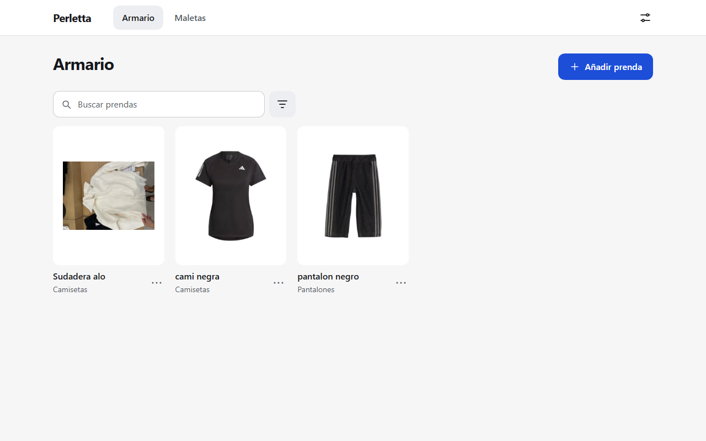
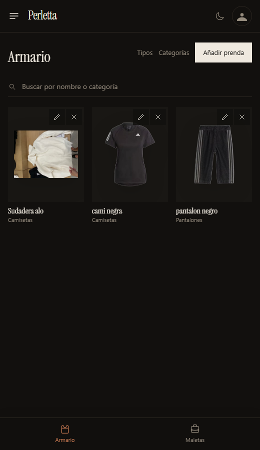

# Perletta

Armario personal y maletas, en el navegador. Se instala como app (PWA) y guarda todo en Supabase.

[mi-armario-sooty.vercel.app](https://mi-armario-sooty.vercel.app)





En `docs/diseno/` están las demás vistas, en móvil y escritorio, claro y oscuro.

## Qué hace

- Añadir prendas con la foto recortada automáticamente en el dispositivo (sin subirla a ningún servicio).
- Organizar prendas por tipo y categoría, buscar y filtrar (el botón junto al buscador abre los filtros y la gestión de tipos y categorías).
- Montar outfits arrastrando las prendas dentro de una maleta; la posición se guarda.
- Crear maletas y duplicarlas; clima del destino y descarga del outfit como imagen.
- Tema claro y oscuro y copia de seguridad en JSON, desde Ajustes.

## Stack

React 19, Vite 8, Tailwind CSS 4, Supabase (Postgres y Storage) y vite-plugin-pwa.

## Arrancar

Necesita dos variables de entorno (`VITE_SUPABASE_URL` y `VITE_SUPABASE_ANON_KEY`), en un `.env` local o en el panel de Vercel.

```
npm install
npm run dev
```

## Acceso

Cada cuenta ve solo su ropa. La cuenta se crea desde la propia pantalla de acceso («¿No tienes cuenta? Crear una»).

1. Pega `supabase/multiusuario.sql` en el **SQL Editor**. Añade `user_id` a todas las tablas, pone la política «cada uno lo suyo» y asigna lo que ya existe al primer usuario de `auth.users`.
2. En **Authentication → Providers → Email**, deja «Enable email provider» activo y desactiva **«Confirm email»**: sin servidor de correo, con la confirmación activada nadie podría entrar después de registrarse.
3. Rota la clave pública: **Settings → API Keys**, crea la publishable key, copia su valor en
   `VITE_SUPABASE_ANON_KEY` (local y en Vercel) y revoca las claves legacy.
   El `.env` viejo sigue en el historial de Git; rotar la clave es lo que lo inutiliza.
4. Despliega **después** del paso 1: si no, las cuentas nuevas verían todo lo anterior.

Las cuentas nuevas heredan el catálogo de tipos y categorías de la primera, así el formulario de prenda no arranca vacío.

## Comprobar

```
npm test    # lógica de outfits y posiciones
npm run lint
npm run build
```

## Estructura

```
src/App.jsx              armario y navegación (con la puerta de acceso)
src/components/          acceso, galería, maletas, formularios, gestores
src/lib/                 caché local y lógica de outfits (con sus tests)
supabase/multiusuario.sql  cuentas separadas: user_id, políticas por dueño y bucket por carpeta
supabase/rls.sql         versión anterior, solo con login y lista de miembros
supabase/limpieza.sql    limpieza opcional de columnas y tablas sin uso
```

## Pendiente

- Tests de interfaz y despliegue continuo.
